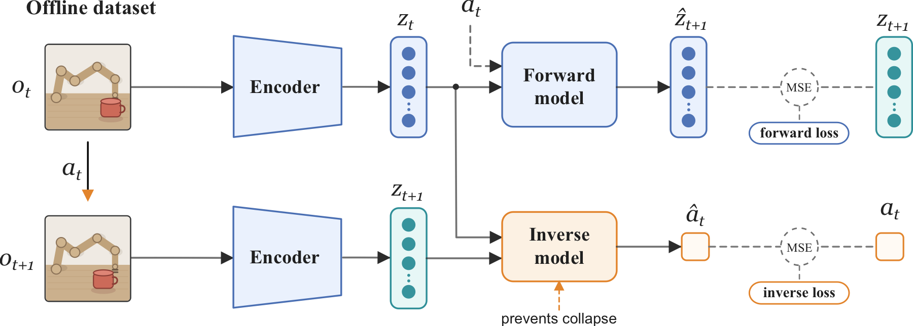

# Sensorimotor World Models
### Perception for Action via Inverse Dynamics

[Petr Ivashkov](https://openreview.net/profile?id=~Petr_Ivashkov1), [Randall Balestriero](https://openreview.net/profile?id=~Randall_Balestriero1), and [Bernhard Schölkopf](https://openreview.net/profile?id=~Bernhard_Sch%C3%B6lkopf1)

[Paper](https://arxiv.org/abs/2606.20104) · [Project page](https://petr-ivashkov.github.io/sensorimotor-world-model.github.io/)

<p align="center"></p>

SMWM learns visual representations by jointly training an encoder, a forward model,
and an inverse model. Inverse dynamics provides the anti-collapse signal:

```text
L = MSE(predicted_next_latent, next_latent) + λ · MSE(predicted_action, action)
```

The main experiments use λ=10. The planning implementation builds on
[LeWorldModel](https://github.com/lucas-maes/le-wm),
[stable-worldmodel](https://github.com/galilai-group/stable-worldmodel), and
[stable-pretraining](https://github.com/galilai-group/stable-pretraining).

## Setup

Install [uv](https://docs.astral.sh/uv/getting-started/installation/), then:

```bash
git clone https://github.com/petr-ivashkov/sensorimotor-world-model.git
cd sensorimotor-world-model
uv sync --locked
source .venv/bin/activate
```

Python 3.12 and dependencies are pinned. Toy experiments and analysis run on CPU,
including macOS. Planning training and simulation use Linux with a CUDA GPU.

## Pretrained models and analysis

[Checkpoints](https://huggingface.co/petr-ivashkov/smwm) and
[analysis data](https://huggingface.co/datasets/petr-ivashkov/smwm-analysis)
are available on Hugging Face. From the repository root, download the saved
embeddings and planning results, plus a TwoRoom checkpoint and image samples:

```bash
python - <<'PY'
from huggingface_hub import snapshot_download

snapshot_download(
    "petr-ivashkov/smwm-analysis", repo_type="dataset", revision="v1.0",
    local_dir="planning/outputs",
    allow_patterns=["embeddings/**", "eval/**", "samples/tworoom/*"],
)
snapshot_download(
    "petr-ivashkov/smwm", revision="v1.0",
    local_dir="planning/outputs/pretrained",
    allow_patterns=["tworoom/smwm/seed0/*", "LICENSE*"],
)
PY
```

Run `jupyter lab` (or select `.venv` in VS Code), then open the
[embedding](planning/analysis/embeddings.ipynb),
[physical-probe](planning/analysis/physical_probes.ipynb), or
[planning-results](planning/analysis/planning_results.ipynb) notebook. These run
on CPU using the downloaded data. See [Planning](planning/README.md#pretrained-models)
to encode images with a checkpoint or download other models.

## Experiments

| Directory | Contents |
|---|---|
| [toy/](toy/README.md) | Dot and sprite worlds: representation geometry, controllable structure, and reconstruction probes. |
| [planning/](planning/README.md) | Pixel-based training and planning on TwoRoom, Reacher, Push-T, and OGBench-Cube; baselines and physical probes. |

Try a short toy experiment:

```bash
python toy/train.py --config toy/config/dot.yaml --smoke
```

For planning, follow the [dataset preparation](planning/README.md#data), then:

```bash
cd planning
python train.py data=tworoom method=smwm seed=0
python eval.py env=tworoom run_dir=outputs/train/tworoom_smwm_seed0
```

The core planning code is in [jepa.py](planning/jepa.py), [module.py](planning/module.py),
[train.py](planning/train.py), and [eval.py](planning/eval.py). Experiment settings live
in [config/](planning/config/); [analysis notebooks](planning/analysis/) read the results of your runs.
Datasets, checkpoints, and generated figures stay outside Git.

## Citation

```bibtex
@misc{ivashkov2026sensorimotor,
  title         = {Sensorimotor World Models: Perception for Action via Inverse Dynamics},
  author        = {Ivashkov, Petr and Balestriero, Randall and Sch{\"o}lkopf, Bernhard},
  year          = {2026},
  eprint        = {2606.20104},
  archivePrefix = {arXiv},
  primaryClass  = {cs.LG},
  url           = {https://arxiv.org/abs/2606.20104}
}
```

## License

[MIT](LICENSE). Third-party code retains its licenses and attribution; see
[THIRD_PARTY_NOTICES.md](THIRD_PARTY_NOTICES.md).
